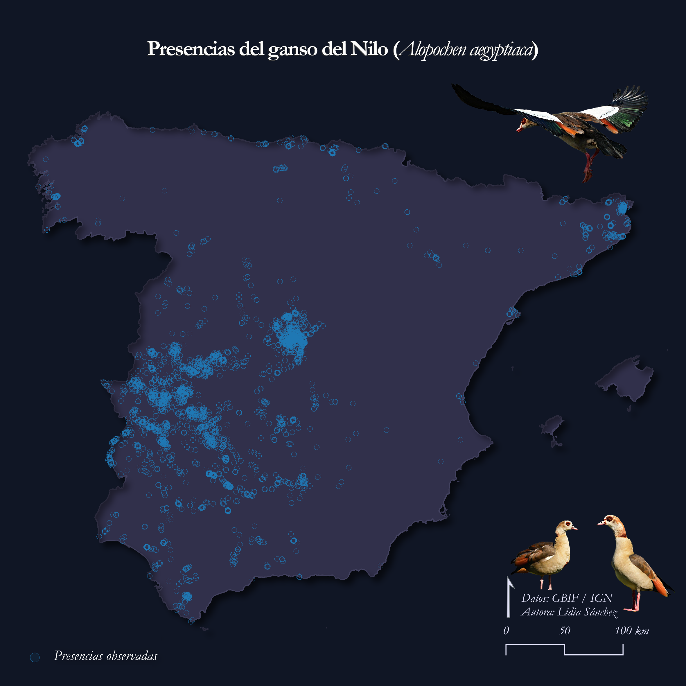
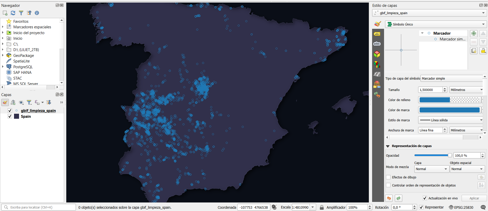
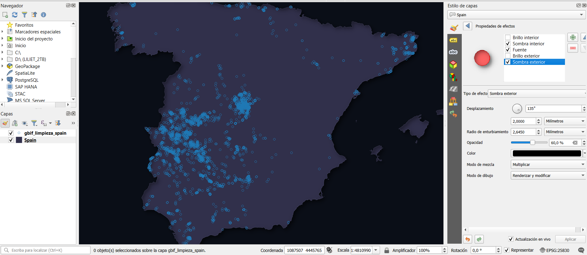

# Día 01: Points

## Presencias del ganso del Nilo en la península ibérica española

## Concepto
El ganso del Nilo (Alopochen aegyptiaca) es una especie incluida en el Catálogo Español de Especies Exóticas Invasoras (Real Decreto 630/2013) y regulada a nivel europeo (Directiva 2009/147/CE y Reglamento (CE) nº 318/2007). Originaria del África subsahariana, ha sido introducida principalmente en Europa y Estados Unidos, mostrando poblaciones estables y en expansión. En España, sus registros se concentran principalmente en Madrid, Extremadura y Cataluña. 
En época reproductiva presenta un comportamiento agresivo frente a otras especies, y usurpa nidos activos de especies autóctonas, como, por ejemplo, milano negro (*Milvus migrans*), milano real (*Milvus milvus*), cigüeña negra (*Ciconia nigra*) o águila pescadora (*Pandion haliaetus*), entre otras. Además, compite por recursos alimenticios, puede ser un reservorio de diferentes patógenos y es considerada una plaga agrícola en Sudáfrica y algunas zonas de Europa.
La primera cita documentada de la especie es de 1985 en Aragón expandiéndose de forma considerable desde entonces. En este mapa se puede observar claramente esta expansión en la península ibérica española, poniendo de manifiesto la importancia de una gestión y control para evitar posibles daños a especies autóctonas y los ecosistemas.

---

## Mapa Final



---

## Proceso técnico en R y QGIS

### 1. Descarga de datos y limpeza
Se descargaron los datos directamente de la web de GBIF.
Se hizo una limpieza básica mediante la función cleanCoords del paquete de R "fuzzySim".

```r
library(fuzzySim)
gbif_limpieza <- fuzzySim::cleanCoords(
  gbif_datos_tabla, 
  coord.cols = c("decimalLongitude", "decimalLatitude"), 
  abs.col = "occurrenceStatus", 
  uncert.col = "coordinateUncertaintyInMeters", 
  uncert.limit = 50000, 
  year.col = "year", 
  year.min = 1970
)
```

> **Criterios de limpieza aplicados:**
> * **Coordenadas:** Elimina valores nulos o situados en cero.
> * **Presencia:** Retiene registros con presencia confirmada (`occurrenceStatus != ABSENT`).
> * **Precisión espacial:** Excluye registros con imprecisión geográfica superior a 50 km.
> * **Temporalidad:** Muestras comprendidas entre 1970 y la actualidad.


### 2. Carga de datos
Se importaron los datos puntuales de presencias y la capa de España en formato vectorial.


### 3. Simbología y maquetación
Para la capa puntual se utilizó una simbología simple con fondo transparente y color de línea azul #1f78b4 (marcador circular). Para la capa base de España se utilizó un color azul grisáceo #31304b con un efecto dibujo con sombra exterior e interior. Se maquetó el diseño en el Diseñador de Impresiones de QGIS añadiendo título, escala y norte. Se terminó de maquetar en Photoshop.




## Fuentes de datos y citas

Este proyecto utiliza datos abiertos procedentes de las siguientes fuentes oficiales y repositorios científicos:

### 1. Registros de presencia de *Alopochen aegyptiaca* (Ganso del Nilo)
* **Fuente:** Global Biodiversity Information Facility (GBIF).
 
 > GBIF.org (2026). *GBIF Occurrence Download*. Available from: https://doi.org/10.15468/dl.r2c3mn [Consultado el 18 de octubre de 2026].

---

### 2. Cartografía base y Límites administrativos
* **Fuente:** Centro de Descargas del Centro Nacional de Información Geográfica (CNIG) / Instituto Geográfico Nacional (IGN) de España.

  > Instituto Geográfico Nacional (IGN). (2026). *Líneas Límite Municipales, Autonómicas y Estatales (ETRS89 / UTM Zone 30N)*. Centro Nacional de Información Geográfica (CNIG). Disponible en: https://centrodedescargas.cnig.es
* **Licencia de uso:** Obra derivada de IGR-RT 2026 CC-BY 4.0 scne.es


## Software y herramientas
* **SIG y maquetación cartográfica:** 
  > QGIS.org (2026). *QGIS Geographic Information System (v. 3.44.12-Solothurn)*. QGIS Association. https://www.qgis.org
* **Edición gráfica y postproducción:** 
  > Adobe Inc. (2012). *Adobe Photoshop* (v. 13.0 x64) [Computer software]. https://www.adobe.com/products/photoshop.html
  >Paquete de R fuzzySim. Barbosa, A.M. (2026). Fuzzy Similarity in Species Distributions. R package version 4.59. URL: http://fuzzysim.r-forge.r-project.org/.

## Bibliografía

Callaghan, C., Brooks, D., & Pyle, P. (2020). Egyptian Goose (Alopochen aegyptiaca), version 1.0. In Birds of the World (S. M. Billerman, Editor). Cornell Lab of Ornithology.

Callaghan, C. T., & Brooks, D. M. (2017). History, current, distribution, and status of the Egyptian Goose (Alopochen aegyptiaca) in the contiguous United States. The Southwestern Naturalist, 62(4).

Davies, G. (2005). Egyptian Goose Alopochen aegyptiacus. In Ducks, Swans, and Geese. Oxford University Press (pp. 401–407). Oxford University Press.

De Swardt, D. (2010). Egyptian Goose Alopochen aegyptiaca hybridizes with Common Shelduck Tadorna tadorna. Ornithological Observations, 1(63–64), 63–64.

De Swardt, D. H. (2012). Nature recycles: Egyptian Goose breeding in old Secretarybird nest. Biodiversity Observations, 223–225.

Gyimesi, A., & Lensink, R. (2012). Egyptian Goose Alopochen aegyptiaca: An introduced species spreading in and from the Netherlands.

Mazurska, K., & Solarz, W. (2016). Risk assessment of Egyptian goose Alopochen aegyptiacus. CIRCABC. CIRCABC.

Navarro, Prieta, Sánchez, García-Martín, & Cardalliaguet. (2024). Censo de aves acuáticas invernantes en Extremadura, enero 2024. Delegación de Extremadura. Sociedad Española de Ornitología.

Prieta Díaz, J. (2022). Ganso del Nilo (Alopochen aegyptiaca). III Atlas de las aves en época de reproducción en España. SEO/BirdLife, Madrid. (B. Molina, A. Nebreda, A. R. Muñoz, J. Seoane, R. Real, J. Bustamante y J. C. del Moral). SEO/BirdLife.

Santos. (2017). Alopochen aegyptiaca (Fichas de Aves Introducidas En España). Grupo de Aves Exóticas (SEO/BirdLife).
