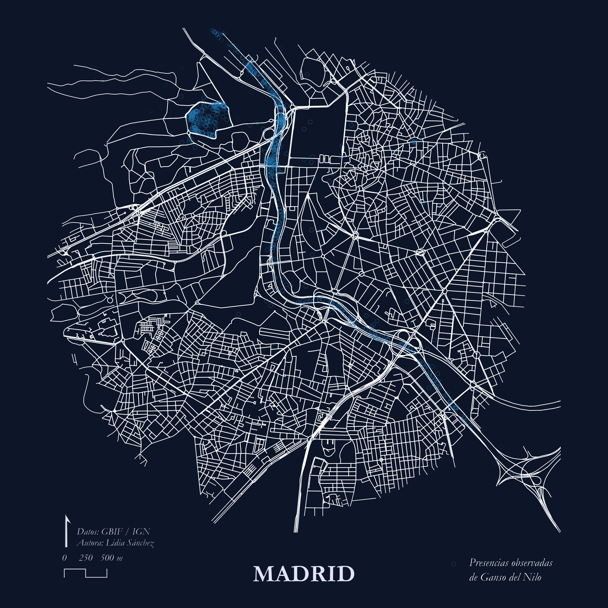
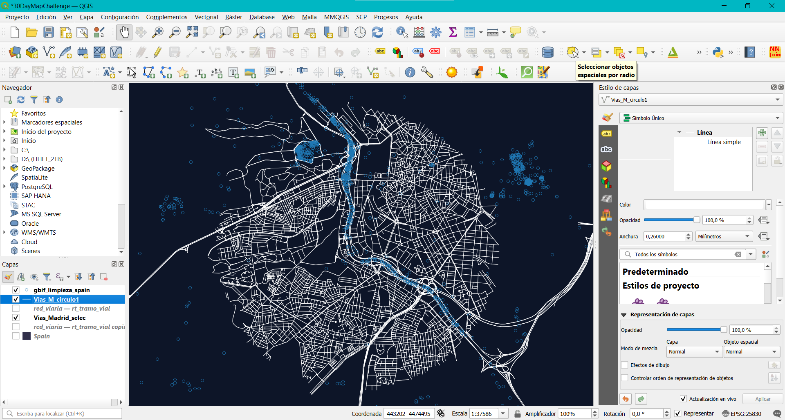

# Día 02: Lines

## Recorriendo el río Manzanares. Ganso del Nilo en Madrid. 

## Concepto
Como ocurre en otros países de Europa (Ámsterdam o Bélgica), esta especie ha encontrado en las zonas urbanas un ecosistema ideal para expandirse. Por el contrario, en Extremadura la especie aún no ha ocupado a gran escala ciudades como Mérida o Badajoz. En los últimos años se han empezado a observar individuos, pero no al nivel de Madrid. En Extremadura ha encontrado su paraíso particular en los grandes embalses y las numerosas lagunas que engloban la comunidad, pero solo es cuestión de tiempo que llegue a asentarse de forma considerable en la urbe.

---

## Mapa Final

---

## Proceso técnico en QGIS

### 1. Carga de datos
Se importaron los datos puntuales de presencias del ganso del Nilo y las infraestructuras viarias de Madrid en formato lineal.

### 2. Selección de objetos
Para obtener el diseño de mapa en circulo se hizo una selección de objetos espaciales por radio de la capa lineal y se guardó la selección como una nueva capa. Para las líneas que sobresalen del círculo se seleccionaron solo los valores “Autopista libre/ Autovía” del campo clased y se guardaron en una nueva capa.

### 3. Simbología y maquetación
Para las capas lineales se utilizó una línea simple sólida de color blanco `#ffffff` con anchura de marca de 0,26 mm. Para la capa puntual se utilizó una simbología simple con fondo transparente y color de línea azul `#1f78b4` (marcador circular). Se maquetó el diseño en el Diseñador de Impresiones de QGIS añadiendo título, escala y norte. Se terminó de maquetar en Photoshop.

## Fuentes de datos y citas

Este proyecto utiliza datos abiertos procedentes de las siguientes fuentes oficiales y repositorios científicos:

### 1. Registros de presencia de *Alopochen aegyptiaca* (Ganso del Nilo)
* **Fuente:** Global Biodiversity Information Facility (GBIF).
 
 > GBIF.org (2026). *GBIF Occurrence Download*. Available from: https://doi.org/10.15468/dl.r2c3mn [Consultado el 18 de octubre de 2026].

---

### 2. Cartografía base y límites administrativos
* **Fuente:** Centro de Descargas del Centro Nacional de Información Geográfica (CNIG) / Instituto Geográfico Nacional (IGN) de España.

  > Instituto Geográfico Nacional (IGN). (2026). *Redes de transporte (ETRS89 / UTM Zone 30N)*. Centro Nacional de Información Geográfica (CNIG). Disponible en: https://centrodedescargas.cnig.es
* **Licencia de uso:** Obra derivada de IGR-RT 2026 CC-BY 4.0 scne.es

## Software y herramientas 
* **SIG y maquetación cartográfica:**
  
  > QGIS.org (2026). *QGIS Geographic Information System (v. 3.44.12-Solothurn)*. QGIS Association. https://www.qgis.org * **Edición Gráfica y Postproducción:**

* **Edición Gráfica y Postproducción:**
  
  > Adobe Inc. (2012). *Adobe Photoshop* (v. 13.0 x64) [Computer software]. https://www.adobe.com/products/photoshop.html

## Bibliografía

Callaghan, C., Brooks, D., & Pyle, P. (2020). Egyptian Goose (Alopochen aegyptiaca), version 1.0. In Birds of the World (S. M. Billerman, Editor). Cornell Lab of Ornithology.

Callaghan, C. T., & Brooks, D. M. (2017). History, current, distribution, and status of the Egyptian Goose (Alopochen aegyptiaca) in the contiguous United States. The Southwestern Naturalist, 62(4).

Davies, G. (2005). Egyptian Goose Alopochen aegyptiacus. In Ducks, Swans, and Geese. Oxford University Press (pp. 401–407). Oxford University Press.

De Swardt, D. (2010). Egyptian Goose Alopochen aegyptiaca hybridizes with Common Shelduck Tadorna tadorna. Ornithological Observations, 1(63–64), 63–64.

De Swardt, D. H. (2012). Nature recycles: Egyptian Goose breeding in old Secretarybird nest. Biodiversity Observations, 223–225.

Gyimesi, A., & Lensink, R. (2012). Egyptian Goose Alopochen aegyptiaca: An introduced species spreading in and from the Netherlands.

Mazurska, K., & Solarz, W. (2016). Risk assessment of Egyptian goose Alopochen aegyptiacus. CIRCABC. CIRCABC.

Navarro, Prieta, Sánchez, García-Martín, & Cardalliaguet. (2024). Censo de aves acuáticas invernantes en Extremadura, enero 2024. Delegación de Extremadura. Sociedad Española de Ornitología.

Prieta Díaz, J. (2022). Ganso del Nilo (Alopochen aegyptiaca). III Atlas de las aves en época de reproducción en España. SEO/BirdLife, Madrid. (B. Molina, A. Nebreda, A. R. Muñoz, J. Seoane, R. Real, J. Bustamante y J. C. del Moral). SEO/BirdLife.

Santos. (2017). Alopochen aegyptiaca (Fichas de Aves Introducidas En España). Grupo de Aves Exóticas (SEO/BirdLife).

