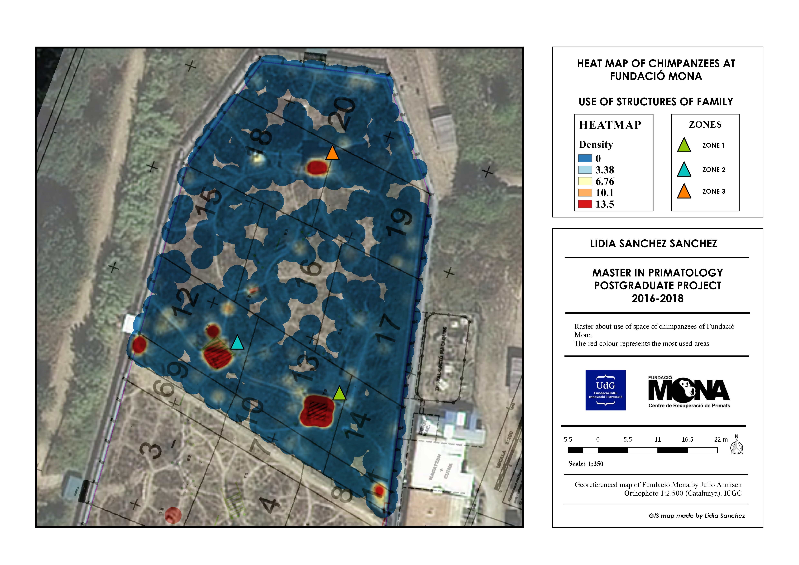
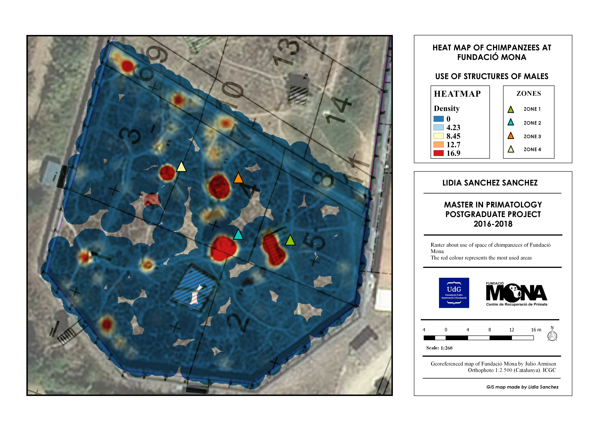
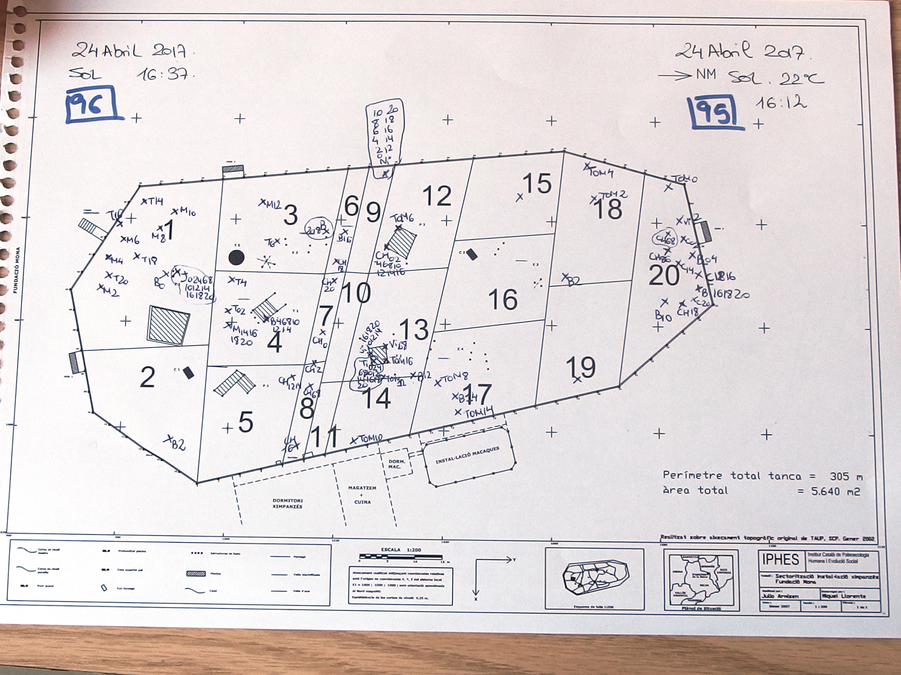

# Día 04: Clusters

## *Uso del espacio en chimpancés dentro en un centro de recuperación*

## Concepto 

En este mapa se evalúa el uso del espacio de los chimpancés (*Pan troglodydes*) que se encontraban en 2016 - 2017 en el centro de recuperación de Fundación Mona (Girona) mediante SIG. El estudio se llevó a cabo con 14 individuos que tenían acceso a un recinto cerrado exterior naturalizado dividido en dos áreas separadas por una valla metálica electrificada (familia y machos). La instalación consta de diferentes plataformas, torres y cuerdas para favorecer la locomoción y descanso de los individuos, además de proporcionar lugares para ocultarse de los visitantes y trabajadores.

Los datos se realizaron mediante un muestreo instantáneo multifocal con un intervalo de dos minutos codificados con un catálogo conductual de veinte comportamientos, clasificados en tres grupos: comportamientos individuales, sociales y otros. Durante los comportamientos sociales se anotaron el emisor y el receptor en el momento de la interacción. Además, se registró la situación geográfica de los individuos en un mapa previamente georreferenciado del recinto exterior del santuario para el posterior análisis.

Los resultados mostraron tres zonas con mayor densidad de comportamientos observados correspondiente a las tres estructuras verticales del recinto de la familia (mapa_final1.png). En cuanto a los comportamientos producidos en estas áreas, los resultados mostraron que en la zona 1 se activaban 3 clases de comportamientos (social affiliate, grooming y self-directed). En la zona 2 se activaban 3 comportamientos (abnormal, feeding y not visible). Y en la zona 3 se activaba 1 comportamiento (feeding).

Con respecto a la zona de los machos, existían cuatro áreas con mayor densidad de comportamientos observados, correspondientes a cuatro de las estructuras de su recinto exterior (mapa_final2.png). En cuanto a los comportamientos producidos en estas áreas, los resultados mostraron que en la zona 1 se activaba 1 comportamiento (self-directed). En la zona 2 se activaban 2 comportamientos (other individuals e inactivity). En la zona 3 se activaban 3 comportamientos (manipulation, feeding, social). Por último, en la zona 4 se activaban 2 comportamientos (inactivity y self-directed).

---

## Mapa Final

---

## Proceso Técnico en QGIS

Se elaboró una capa vectorial de puntos sobre una ortofoto con una resolución de 25 cm (Catalunya 1:2.500) del sitio de estudio, en base a los datos obtenidos previamente (paso1_proceso.png). 

Para evaluar las zonas más utilizadas por los individuos se realizó un mapa de densidad con el complemento “Heatmap” versión 0.2, con un valor de radio de 2 m y 10 cm de resolución de cada pixel. La forma del Kernel fue cuártica (triponderada). De esta forma, las zonas con mayor densidad son aquellas donde existen mayor número de comportamientos observados; y las zonas con menor densidad son aquellas en el que hay un menor número de comportamientos observados. Además, se usó el peso a partir del valor “Contador” (número de veces que un individuo hace el mismo comportamiento (con igual emisor y receptor en comportamientos sociales) sin cambiar de posición geográfica).

Posteriormente, se analizó estadísticamente la relación entre la zona y el comportamiento de los individuos.

## Fuentes de Datos y Citas

### 1. Registros de comportamiento y uso:
* Llevados a cabo por la autora entre el 18 de febrero y el 24 de abril de 2017.

 
---

### 2. Ortofoto y mapa recinto del centro de recuperación
* **Fuente:** Ortofoto.

  > INSTITUT CARTOGRÀFIC I GEOLÒGIC DE CATALUNYA. Ortofotomapa de Catalunya 1:2.500 [en línea]. Escala 1:2.500. Barcelona: ICGC, 2023. [Consulta: 25 de octubre de 2026]. Disponible en: https://www.icgc.cat.

* **Fuente: Mapa del recinto del centro de recuperación georreferenciado por Julio Armisen.

### Software y Herramientas 
* **SIG y Maquetación Cartográfica:** 

> QGIS.org (2017). *QGIS Geographic Information System (v. 2.18-Las Palmas)*. QGIS Association. https://www.qgis.org

