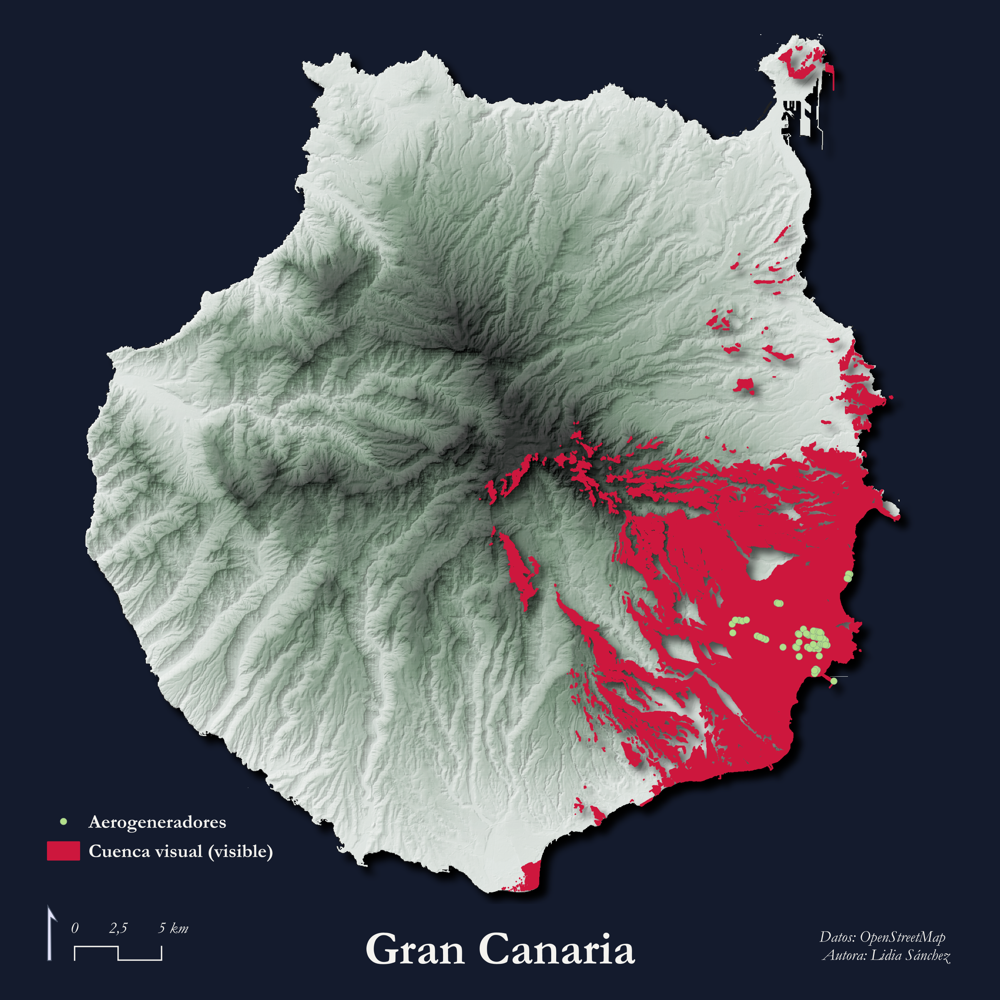
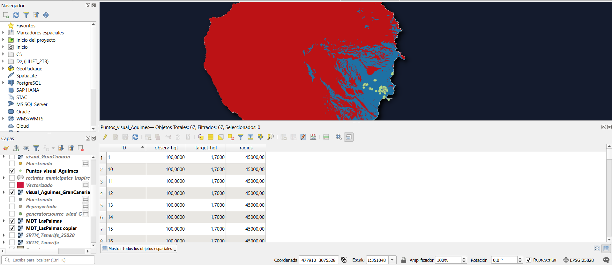

# Día 05: Sight

## Agüimes: Impacto visual de la Infraestructura Eólica

## Concepto

En este mapa se evalúa el impacto paisajístico e insular de las infraestructuras eólicas del municipio de **Agüimes** sobre la isla de Gran Canaria, Islas Canarias. Agüimes concentra una de las densidades de producción eólica más elevadas del archipiélago, condicionando la percepción visual del territorio desde múltiples cuencas del sureste y cumbre insular.

---

## Mapa final

---

## Proceso técnico en QGIS

### 1. Análisis de cuenca visual (Viewshed)

En lugar de un análisis de visibilidad local simplificado, se ha evaluado el impacto visual combinado de 67 aerogeneradores mediante el complemento *Visibility Analysis* en QGIS sobre un Modelo Digital del Terreno.

Primero se ejecutó la preparación de puntos de observación mediante la herramienta Create Viewpoints: altura turbina 100 metros; altura objetivo: 1.70 metros; y radio máximo de análisis de 45 km. Posteriormente se hizo un cálculo de visibilidad (Viewshed).

### 3. Simbología y maquetación

Se aplicó una paleta desaturada bicolor y un sombreado del relieve suave para evitar la saturación visual. Se vectorizó la capa ráster resultante para una mejor simbolización `#e41948`. Se dejó una capa base de relieve sombreado (Hillshade) integrada a baja opacidad (40%) para mantener la visibilidad de la topografía. Color de Fondo `#C5D1D9`. Se maquetó el diseño en el Diseñador de Impresiones de QGIS añadiendo título, escala y norte.

---

## Fuentes de datos y citas

Este proyecto utiliza datos abiertos procedentes de las siguientes fuentes oficiales:

### 1. Infraestructura Eólica
- **Fuente:** OpenStreetMap mediante la API de QuickOSM.
  > OpenStreetMap contributors (2026). *Data retrieved via QuickOSM plugin for QGIS*. Disponible en: https://www.openstreetmap.org

---

### 2. Cartografía base y Modelo Digital del Terreno
- **Fuente:** Centro de Descargas del Centro Nacional de Información Geográfica (CNIG) / Instituto Geográfico Nacional (IGN) de España.
  > Instituto Geográfico Nacional (IGN). (2026). *Modelo Digital del Terreno (MDT) y Cartografía de Límites Administrativos (ETRS89 / UTM zone 28N)*. Centro Nacional de Información Geográfica (CNIG). Disponible en: https://centrodedescargas.cnig.es
- **Licencia de uso:** CC-BY 4.0 scne.es

---

### Software y herramientas

- **SIG y maquetación cartográfica:**
  > QGIS.org (2026). *QGIS Geographic Information System (v. 3.44.12-Solothurn)*. QGIS Association. https://www.qgis.org

- **Complementos de QGIS:**
  > Visibility Analysis Plugin (Zoran Čučković) 
  > QuickOSM Plugin
