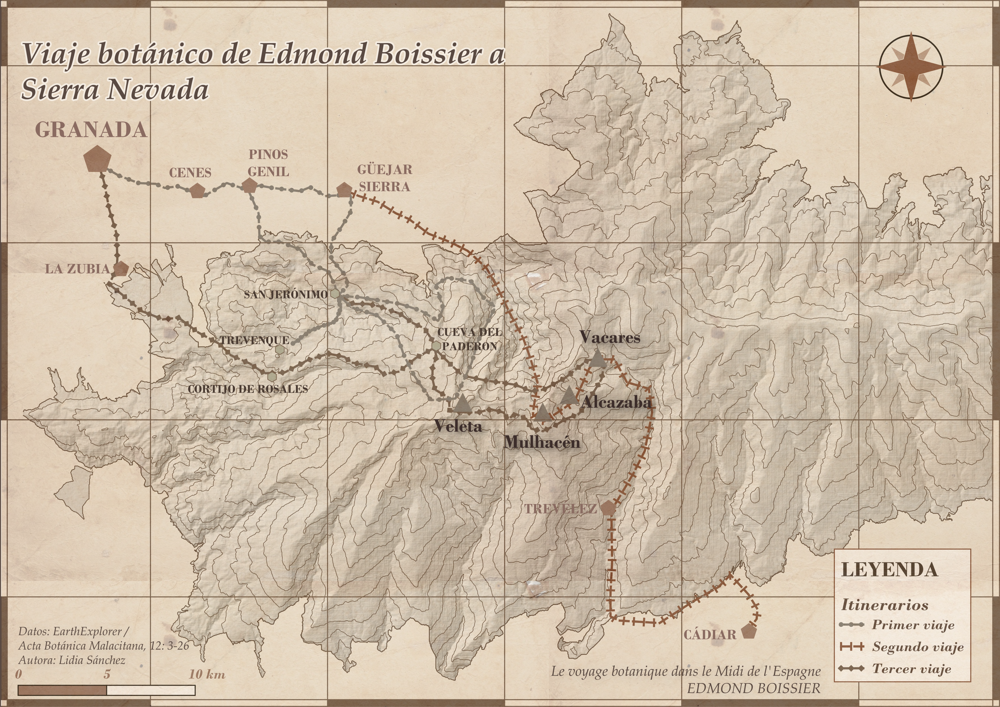
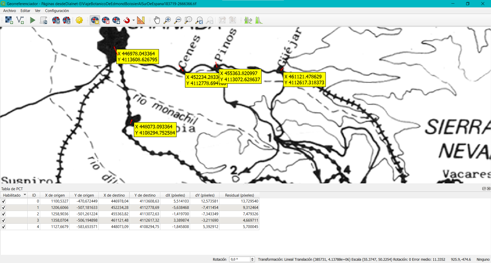
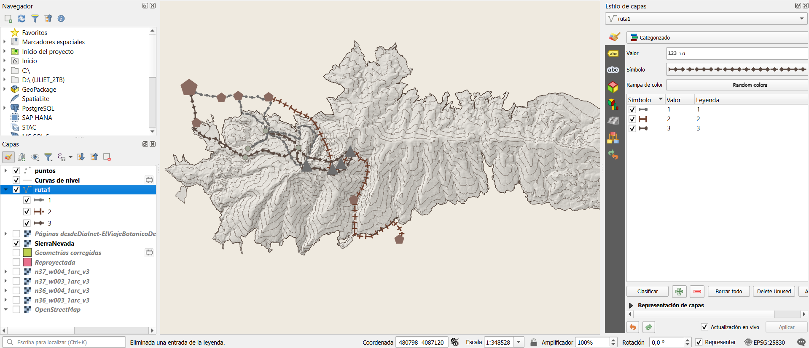

# Día 06: Vintage

## Viaje botánico de Edmond Boissier a Sierra Nevada 

## Concepto
En este mapa se recrea la expedición botánica que llevó a cabo el botánico **Pierre Edmond Boissier** en 1837 a través de **Sierra Nevada (Granada)**, donde describió numerosos endemismos como la Estrella de las Nieves (*Plantago nivalis*) o la Manzanilla de Sierra Nevada (*Artemisa granatensis*). Este recorrido supuso la base fundamental para el conocimiento de la flora alpina del sur peninsular, plasmado en su obra Voyage botanique dans le Midi de l'Espagne pendant l'année 1837. 
Para documentar este proyecto y reconstruir espacialmente el itinerario histórico, se ha empleado el estudio monográfico El viaje botánico de Edmond Boissier al sur de España (1837-1987), publicado en Acta Botánica Malacitana (12: 3-26).
---

## Mapa Final

---

## Proceso técnico en QGIS

### 1. Carga y procesamiento del DEM

Se añadió las capas DEM obtenidas en EarthExplorer. Se hizo una combinación para integrar las capas ráster continuas en una única escena de la zona sur de España. Se reproyecto el DEM combinado al sistema de referencia local **ETRS89 / UTM zone 30N (EPSG:25830). Por último, se hizo un recorte de la capa ráster utilizando como máscara el Parque Natural de Sierra Nevada.

### 2. Georreferenciación e itinerarios históricos

- **Georreferenciación de Cartografía Histórica:** Se importó la lámina del mapa de la expedición extraída de la publicación académica:
  > Valle, F. & Morales, C. (1987). *El viaje botánico de Edmond Boissier al sur de España (1837-1987)*. Acta Botánica Malacitana, 12: 3-26.
  Se utilizó el **Georreferenciador de QGIS** aplicando puntos de control (GCP) sobre elementos orográficos reconocibles para ajustar espacialmente la imagen histórica sobre el terreno real.
- **Digitalización Vectorial:**
  - **Rutas e Itinerarios:** Creación de una capa vectorial de líneas para digitalizar a mano alzada el trazado de las rutas seguidas por Boissier a través de los valles y altas cumbres.
  - **Puntos de Interés:** Creación de una capa de puntos para digitalizar municipios, parajes históricos, pasos de montaña y cumbres emblemáticas como el Mulhacén y Veleta).

### 3. Simbología y maquetación

Se generó una capa de relieve sombreado (Hillshade), integrada mediante modo de fusión **Multiplicar** (*Multiply*) al 35% de opacidad sobre un fondo de papel con color pergamino (`#F4EFE6`).
Para las curvas de nivel se extrajeron isolíneas cada 100 metros con estilo de línea fina en tono sepia(`#4A3B32`).
Para los itinerarios se hicieron diferentes trazos de línea punteada (`#6e6e6e`, `#703f2c`, `#5a4a42`).
Se maquetó el diseño en el Diseñador de Impresiones de QGIS añadiendo título, escala y norte.

---

## Fuentes de datos y citas

Este proyecto combina datos espaciales globales y ministeriales con fuentes bibliográficas históricas:

### 1. Modelo Digital del Terreno (DEM)
- **Fuente:** U.S. Geological Survey (USGS) - EarthExplorer.
  > USGS (2026). *Shuttle Radar Topography Mission (SRTM) / Digital Elevation Data*. U.S. Geological Survey. Disponible en: https://earthexplorer.usgs.gov

---

### 2. Espacios protegidos
- **Fuente:** Ministerio para la Transición Ecológica y el Reto Demográfico (MITERD) / Instituto Geográfico Nacional (IGN).
  > MITERD (2026). *Red de Espacios Naturales Protegidos de España*. Banco de Datos de la Naturaleza. Disponible en: https://www.miteco.gob.es/es/cartografia-y-sig/ide/descargas/biodiversidad/enp.html

---

### 3. Fuentes Botánicas
- **Fuente:** Revista científica *Acta Botánica Malacitana*.
  > Valle, F. & Morales, C. (1987). *El viaje botánico de Edmond Boissier al sur de España (1837-1987)*. Acta Botánica Malacitana, 12: 3-26. ISSN 0210-9506.

- **Fuente:**
  > Boissier, E. (1839–1845). Voyage botanique dans le Midi de l'Espagne pendant l'année 1837. Gide et J. Baudry, París.

---

### Software y herramientas

- **SIG y maquetación cartográfica:**
  > QGIS.org (2026). *QGIS Geographic Information System (v. 3.44.12-Solothurn)*. QGIS Association. https://www.qgis.org

