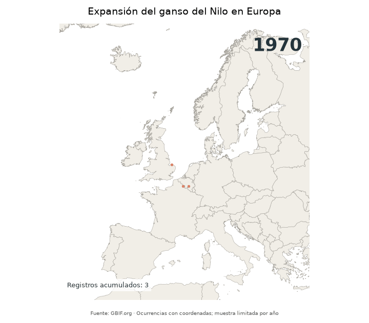

# Día 10: Prompting only

## Expansión del ganso del Nilo en Europa

## Concepto

Este mapa animado muestra cómo han ido apareciendo, año a año, los registros del ganso del Nilo (*Alopochen aegyptiaca*) en Europa. Es una especie originaria de África que hoy se observa en numerosos países europeos.

Todo el proceso se ha hecho solo con prompts. El código lo ha generado un asistente de IA (GitHub Copilot en Visual Studio Code) a partir de una serie de instrucciones, con una edición posterior del script en MAX_PER_YEAR = 2000 para una mejor visualización de las observaciones (originalmente era de 500). 

Los puntos son registros de observación de la plataforma de GBIF en Europa. El aumento de registros a lo largo del tiempo combina la expansión real de la especie con un mayor número de observadores y de plataformas de ciencia ciudadana.

---

## Mapa Final

---

## Proceso técnico en Python (con prompts)

### 1. Entorno

Se trabajó en Visual Studio Code con Python 3.15.2 y un entorno virtual. Librerías utilizadas: `requests`, `pandas`, `geopandas`, `matplotlib`, `pillow`. 

### 2. Obtención de datos (API de GBIF)

- Se obtuvo el identificador de la especie con el servicio de coincidencia de nombres de GBIF.
- Se consultó el número de registros por año en Europa (con coordenadas y sin problemas geoespaciales) antes de descargar nada.
- Se descargaron los registros por año con paginación y un tope de 2000 registros por año, guardando una caché local en CSV.

### 3. Limpieza

Se eliminaron los registros sin coordenadas y los duplicados exactos de coordenadas dentro de cada año. 

### 4. Mapa y animación

- Los puntos se reproyectaron a ETRS89-LAEA (EPSG:3035), con los países de Natural Earth como fondo.
- Cada fotograma corresponde a un año: los puntos de años anteriores aparecen en un color tenue y los del año actual, resaltados, con el año y el recuento acumulado en pantalla.
- La animación se generó con `matplotlib` (`FuncAnimation` y `PillowWriter`) y se guardó como GIF.

---

## Prompt utilizado

Creado previamente con ayuda de Claude:

Crea un archivo llamado ganso_europa.py en la carpeta del proyecto con un único script de Python 3 que cree un GIF animado de la expansión del ganso del Nilo (Alopochen aegyptiaca) en Europa, año a año, usando datos de la API de GBIF.
Requisitos:

1. Parámetros al principio del archivo, fáciles de cambiar:
o MAX_PER_YEAR (tope de registros por año; valor inicial 500 para probar)
o YEAR_MIN y YEAR_MAX (deduce un rango razonable a partir de los datos)
o ruta de salida del GIF y carpeta de caché
2. Obtención de datos:
o Obtén el taxonKey de la especie con el endpoint species/match de GBIF.
o Antes de descargar, consulta occurrence/search con limit=0 y facet=year (filtrando por continente Europa, con coordenadas y sin problemas geoespaciales) e imprime y guarda en CSV el número de registros por año.
o Descarga después los registros por año con paginación, aplicando MAX_PER_YEAR, y guarda una caché en CSV para no repetir peticiones. Respeta los límites de paginación de la API y gestiona errores y tiempos de espera con pausas cortas entre peticiones.
o Quita registros sin coordenadas y duplicados exactos de coordenadas dentro de cada año.
3. Mapa:
o Crea un GeoDataFrame en EPSG:4326 y reproyéctalo a EPSG:3035.
o Usa los países de Natural Earth como fondo. Si la versión de geopandas no incluye el dataset, descárgalo por URL desde el sitio de Natural Earth.
o Recorta la vista a Europa occidental y central para que no quede dominada por puntos lejanos.
4. Animación:
o Un fotograma por año.
o Puntos de años anteriores en un color tenue, puntos del año actual resaltados, y el año en grande en una esquina.
o Un contador de registros acumulados, un título y una nota de fuente (GBIF).
o Guárdala como GIF con matplotlib FuncAnimation y PillowWriter, con un tamaño de figura moderado para que el archivo no sea enorme.
5. Entrega:
o Dime qué librerías instalar con pip.
o Explica cada parte del código paso a paso.
o Dime explícitamente qué parámetros de la API, funciones o comportamientos de librerías no estás 100% seguro de que existan o funcionen así, para que yo los verifique. No inventes endpoints ni parámetros.

### Qué revisé yo

El código lo escribió la IA, pero comprobé que el número de registros descargado por año coincide con el que muestra GBIF y modifique MAX_PER_YEAR a 2000 para una mejor visualización de las observaciones.

---

### Script

[Notebook en GitHub](ganso_europa.ipynb)

---

## Fuentes de datos y citas

### 1. Registros de presencia

- **Fuente:** GBIF (Global Biodiversity Information Facility), consultado mediante su API.
  > GBIF.org ([fecha de consulta]). *GBIF Occurrence Data: Alopochen aegyptiaca*. Disponible en: https://www.gbif.org

### 2. Cartografía base

- **Fuente:** Natural Earth.
  > Natural Earth. *Free vector and raster map data*. Disponible en: https://www.naturalearthdata.com

---

### Software y herramientas

- **Lenguaje y entorno:**
  > Python (3.15.2) en Visual Studio Code.
- **Asistente de IA:**
  > Claude 4.23118.0.
  > GitHub Copilot.

