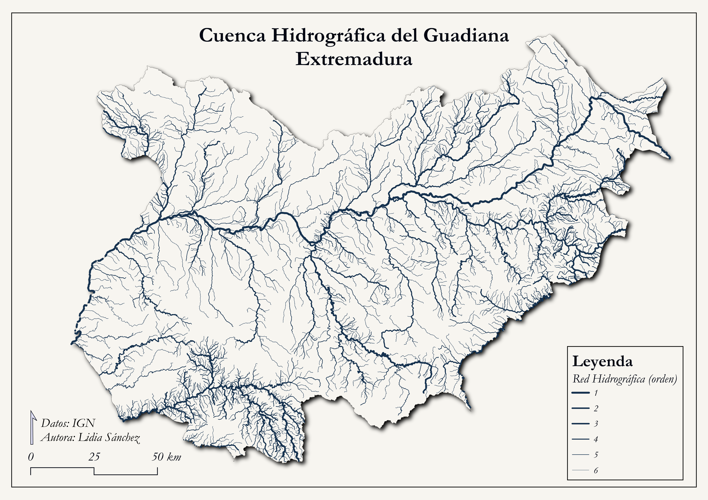

# Día 24: Network

## Conectividad fluvial: Red hidrográfica de la cuenca del Guadiana en Extremadura

## Concepto

En este mapa se visualiza la red hidrográfica de la cuenca del Guadiana en Extremadura como un sistema de conexión territorial, donde los cauces principales y secundarios funcionan como una red ramificada que articula el drenaje, el transporte de agua y la relación ecológica entre tramos y territorios. Al no haber elementos topográficos de fondo se puede apreciar con claridad la geometría, densidad y jerarquía natural de una infraestructura ecológica clave para la conectividad del paisaje.

---

## Mapa Final

---

## Proceso Técnico en QGIS

### 1. Carga de datos

Se cargó la capa vectorial de la red hidrográfica procedente del Instituto Geográfico Nacional (IGN). Posteriormente se hizo un recorte dentro de la cuenca del Guadiana en Extremadura.

### 2. Simbología y procesamiento

- **Red hidrográfica:** Se aplicó una simbología categorizada en base al orden (hasta 6), utilizando un color azul oscuro `#16324F` sobre un fondo claro `#F7F5F0`, ajustando grosores según el orden.

Se maquetó el diseño en el Diseñador de Impresiones de QGIS añadiendo título, escala y norte.

---

## Fuentes de datos

Este proyecto utiliza datos abiertos procedentes de las siguientes fuentes oficiales:

### 1. Red hidrográfica

- **Fuente:** Instituto Geográfico Nacional (IGN).
  > Instituto Geográfico Nacional (2026). Red Hidrográfica. Centro de Descargas del CNIG. Disponible en: https://centrodedescargas.cnig.es

---

### Software y herramientas

- **SIG y maquetación cartográfica:**
  > QGIS.org (2026). *QGIS Geographic Information System (v. 3.44.12-Solothurn)*. QGIS Association. https://www.qgis.org
